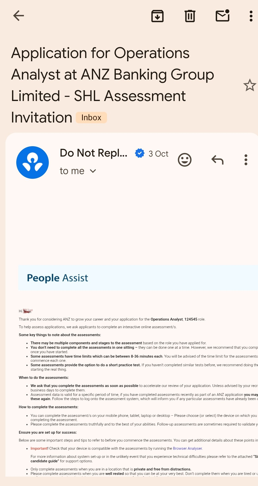

# ApplyMate — Auth

Premium auth experience: sign up, magic-link email verification, Google OAuth,
sign in, password reset, and role-based onboarding (student vs. early-career
professional). Built React + Vite + TypeScript + Tailwind + Supabase.

## Setup

```bash
npm install
cp .env.example .env   # fill in your Supabase URL + anon key
```

In the Supabase SQL editor, run `supabase/schema.sql`. It creates:
- `profiles` (auto-created on signup via trigger, activated on verification)
- `student_details` / `professional_details` (onboarding data)
- a private `resumes` storage bucket with per-user RLS

In **Authentication → Providers**: enable Email and Google.
In **Authentication → URL Configuration**: add `http://localhost:5173/auth/callback`
and your production `https://yourdomain.com/auth/callback` as redirect URLs.

```bash
npm run dev
```

## Flow

1. `/sign-up` — name, email, password, confirm. Duplicate-email and
   password-strength checks run before submit.
2. `/check-inbox` — "check your inbox" screen with resend (45s cooldown)
   and change-email.
3. User clicks the magic link → `/auth/callback` verifies the session,
   ensures a profile row exists, and activates the account.
4. `/onboarding` — role picker, then student or professional fields
   (college/CGPA vs. previous role), resume upload to Supabase Storage.
5. `/dashboard` — placeholder landing point for the rest of the product.

`/sign-in` supports email+password and Google, with session persistence
and "Forgot password" → `/reset-password`.

## Notes

- No OTP anywhere — verification and password reset are both link-based.
- `ProtectedRoute` guards `/onboarding` and `/dashboard`.
- Swap the `Dashboard` stub for the real application-tracker UI next.

## Proof

Real application outcome: ANZ Operations Analyst assessment invitation.


